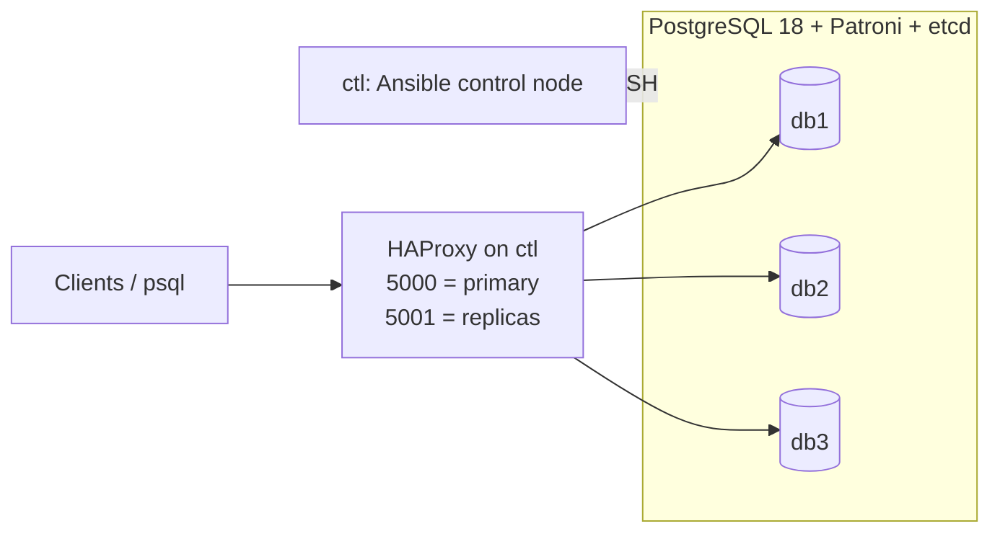

# PostgreSQL 18 HA Lab — Patroni, etcd and HAProxy as code with Ansible

A reproducible 3-node PostgreSQL 18 cluster that rebuilds from scratch with one command,
plus hands-on labs on backup, PITR with pgBackRest, and replication.

## Highlights

- **One-command rebuild:** `ansible-playbook playbooks/site.yml` builds etcd, Patroni and HAProxy
  from empty VMs and validates the result (1 leader + 2 streaming replicas, routing on 5000/5001).
- **Idempotent by design:** the build and configuration playbooks report `changed=0` on a second run.
- **Secrets handled properly:** passwords live only in Ansible Vault, behind plain aliases,
  and are rotated by a playbook without restarting PostgreSQL or changing the leader.
- **Databases, users and privileges as code** with `community.postgresql`.
- **Rolling patch:** patched the cluster to PostgreSQL 18.6 node by node (replicas first,
  then a Patroni switchover), with writes paused only during the switchover.
- **Failure drills:** automatic failover, switchover, replica rejoin with pg_rewind,
  and point-in-time recovery after an accidental DROP.

## Coming from Oracle

| Oracle | PostgreSQL in this lab |
| ------ | ---------------------- |
| Data Guard + Fast-Start Failover | Streaming replication + Patroni + etcd |
| Observer | etcd quorum (3 nodes) |
| SCAN listener / service | HAProxy (5000 = primary, 5001 = replicas) |
| RMAN + archived redo | pgBackRest + WAL archiving |
| Flashback / point-in-time recovery | PITR with recovery_target_time |
| Undo tablespace | MVCC row versions + VACUUM |

## Architecture



| VM  | IP            | Role                                                   |
| --- | ------------- | ------------------------------------------------------ |
| db1 | 192.168.56.11 | PostgreSQL 18 + Patroni + etcd                         |
| db2 | 192.168.56.12 | PostgreSQL 18 + Patroni + etcd                         |
| db3 | 192.168.56.13 | PostgreSQL 18 + Patroni + etcd                         |
| ctl | 192.168.56.10 | Ansible control node, HAProxy, psql client             |

## Skills shown

- PostgreSQL 18 administration: architecture, roles and privileges, configuration and tuning
- MVCC, VACUUM, bloat and transaction ID wraparound
- Backup and recovery: pg_dump, pg_basebackup, pgBackRest, point-in-time recovery
- Physical and logical replication, failover and switchover
- High availability with Patroni, etcd and HAProxy
- Infrastructure as code with Ansible: roles, templates, handlers, Ansible Vault,
  `community.postgresql`, idempotent playbooks, rolling patching with `serial: 1`

## Repository map

| Folder | Content |
| ------ | ------- |
| [`infra/`](infra/) | Vagrant definition of the 4 VMs and Windows helper scripts |
| [`postgresql/01-architecture`](postgresql/01-architecture/) | Processes, memory, files |
| [`postgresql/02-role-schemas_tablespace`](postgresql/02-role-schemas_tablespace/) | Roles, schemas, grants, tablespaces |
| [`postgresql/03-mvcc-vacuum`](postgresql/03-mvcc-vacuum/) | MVCC, VACUUM, bloat |
| [`postgresql/04-settings-parameters`](postgresql/04-settings-parameters/) | Configuration and memory tuning with pgbench |
| [`postgresql/05-backup`](postgresql/05-backup/) | Logical and physical backup |
| [`postgresql/06-restore-pitr`](postgresql/06-restore-pitr/) | Restore, PITR, pgBackRest |
| [`postgresql/07-replication`](postgresql/07-replication/) | Streaming replication, slots, failover |
| [`postgresql/08-logical-replica-patroni`](postgresql/08-logical-replica-patroni/) | Logical replication, Patroni |
| [`ansible/`](ansible/) | The whole cluster as code: see its [README](ansible/README.md) |
| [`ansible/roles/`](ansible/roles/) | `common`, `etcd`, `patroni_cluster`, `haproxy`, `pg_client` |
| [`ansible/playbooks/`](ansible/playbooks/) | `site.yml` (build and validate), `db_objects.yml` (databases, users, privileges), `rolling_patch.yml` (rolling patch with switchover), `rotate_passwords.yml` (password rotation, Patroni reload only) |
| [`ansible/inventory/`](ansible/inventory/) | Hosts, groups, `vars.yml` and the encrypted `vault.yml` |

## How to reproduce

```bash
# On the host (VirtualBox + Vagrant)
cd infra
vagrant up

# On ctl
vagrant ssh ctl
cd ~/lab-dba/ansible
ansible-galaxy collection install -r requirements.yml
echo 'your-vault-password' > ~/.vault_pass && chmod 0600 ~/.vault_pass
ansible-playbook playbooks/site.yml          # etcd + Patroni + HAProxy + validation
ansible-playbook playbooks/db_objects.yml    # databases, users and privileges
ansible-playbook playbooks/rolling_patch.yml # day-2: rolling minor-version patch
ansible-playbook playbooks/rotate_passwords.yml # day-2: rotate postgres and replication passwords
```

## Roadmap

- Ansible: ansible-lint in CI and a shared role for the PGDG repository
- Terraform and AWS (RDS and Aurora PostgreSQL)
- Oracle to PostgreSQL migration with AWS SCT and DMS
- PostgreSQL on Kubernetes with CloudNativePG
- AI workloads on PostgreSQL with pgvector
